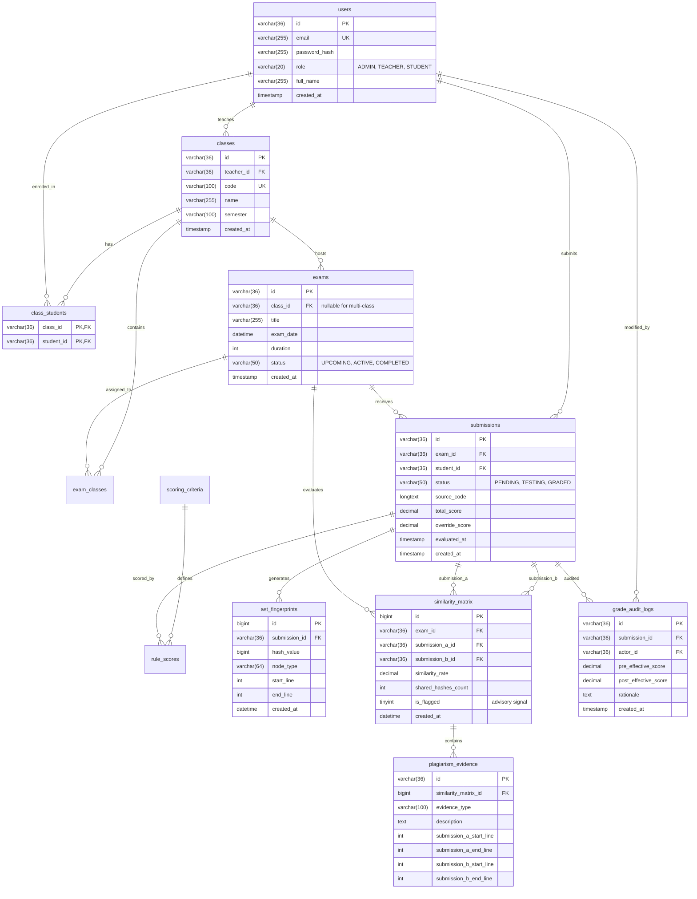

# CODEASSESS — KIẾN TRÚC HỆ THỐNG, CƠ SỞ DỮ LIỆU & SƠ ĐỒ WORKFLOW 2 (MILESTONE 2)

**Dự án:** CodeAssess — Intelligent Programming Assessment & AST Plagiarism Detection Platform  
**Phân hệ:** Architecture, Database ERD & Student Workflow 2  
**Người lập / Author:** Kim (`kimalone2004` / `155179325+kimalone2004@users.noreply.github.com`)  
**Ngày cập nhật:** 18/10/2026  
**Mã Task nghiệm thu:** M2-18 (P2)  

---

## 1. Phân Tách Giữa Đặc Tả SRS Baseline và Cơ Sở Dữ Liệu Thực Tế

Theo tiêu chí Task M2-18 ("*Tách SRS baseline khỏi schema đã xác minh*"):

1. **Danh mục 10 Bảng theo SRS Baseline (Lý thuyết ban đầu):**
   - `users`, `course_classes`, `class_students`, `exams`, `programming_questions`, `submissions`, `ast_fingerprints`, `similarity_pairs`, `plagiarism_evidence`, `appeals`.
   - *Ghi chú khoảng trống:* Bảng `programming_questions` **không tồn tại dưới dạng bảng vật lý độc lập** trong MySQL hiện tại. Thay vào đó, mỗi kỳ thi (`exams`) gắn trực tiếp với 1 bài tập lập trình độc lập (Single-task model). Bảng `similarity_pairs` trong SRS thực tế được đặt tên vật lý là `similarity_matrix`.

2. **Danh mục 12 Bảng Thực Tế Đang Vận Hành (MySQL Physical Schema V1 $\rightarrow$ V8):**
   - Đã được chuẩn hóa qua các bản Flyway Migration:
     1. `users`: Tài khoản người dùng (Admin, Teacher, Student).
     2. `classes`: Lớp học phần do giảng viên phụ trách.
     3. `class_students`: Bảng nối học viên ghi danh vào lớp.
     4. `exams`: Kỳ thi lập trình.
     5. `exam_classes` *(Bổ sung V7)*: Hỗ trợ kỳ thi đa lớp (Many-to-Many).
     6. `submissions`: Bài nộp mã nguồn Java của sinh viên.
     7. `scoring_criteria` *(Bổ sung V5)*: Danh mục tiêu chí chấm điểm rubric.
     8. `rule_scores` *(Bổ sung V5)*: Điểm thành phần theo từng tiêu chí cho bài nộp.
     9. `ast_fingerprints`: Bộ dấu vân tay AST sau khi chạy thuật toán Winnowing.
     10. `similarity_matrix`: Ma trận kết quả so sánh cặp bài nộp (tương đương `similarity_pairs`).
     11. `plagiarism_evidence`: Tọa độ dòng mã nguồn trùng khớp giữa 2 bài nộp.
     12. `grade_audit_logs` *(Bổ sung V6)*: Nhật ký kiểm toán bất biến khi giảng viên sửa điểm hoặc sửa rubric.

---

## 2. Sơ Đồ Thực Thể Liên Kết Thực Tế (Physical Database ERD)

