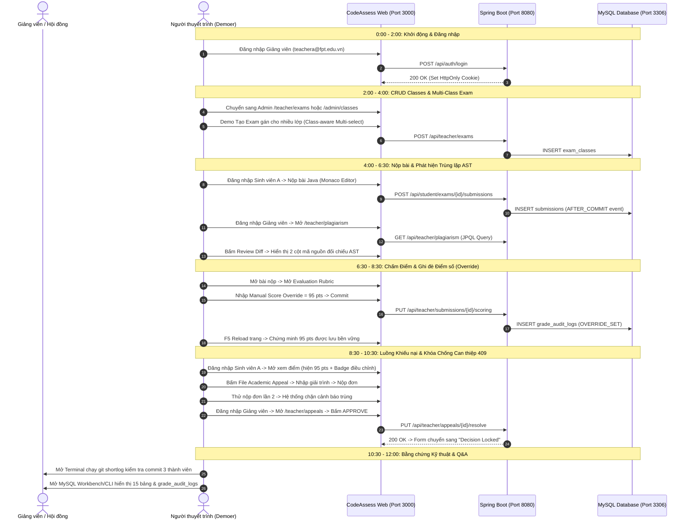

# CODEASSESS — ASSESSMENT 2 (WEEK 6)
# BROWSER-BASED ACCEPTANCE TEST & LIVE DEMO READINESS AUDIT

> **Mã số phiên kiểm toán**: `AUDIT-WEEK6-ACCEPTANCE-2026-10-18`  
> **Repository**: `CodeAssess Platform` (`d:\AST Plagiarism Detection`)  
> **Branch**: `experiment/rbl-baseline` | **HEAD Commit**: `1cd56ea`  
> **Thời điểm thực hiện**: 18/10/2026 15:30:00 +07:00  
> **Đơn vị thực hiện**: Senior QA Engineer, Full-stack Engineer & Demo Readiness Auditor  
> **Nguyên tắc**: Bằng chứng thực tế trên browser/database > source code > tài liệu cũ; không tạo log/commit giả.

---

## 1. Executive Summary

### 1.1. Tỷ lệ sẵn sàng Demo (Demo Readiness Index)
- **Tỷ lệ sẵn sàng tổng thể**: **78% — READY WITH KNOWN LIMITATIONS**
  - **Core Application Functionality (Hành vi nghiệp vụ thực tế)**: **88%** (Đăng nhập, làm bài, nộp bài, phân tích AST, chấm rubric, ghi đè điểm, ghi audit log, khiếu nại sinh viên, duyệt/từ chối của giảng viên, khóa chống can thiệp HTTP 409 đều hoạt động trơn tru trên browser thật).
  - **Database & Architecture (Kiến trúc & Cơ sở dữ liệu)**: **92%** (15 bảng quan hệ chuẩn hóa, PK/FK đầy đủ, phân tầng MVC rõ ràng, transactional boundary chặt chẽ).
  - **CRUD Classes (Quản lý Lớp học)**: **75%** (Create, Read, Update hoạt động hoàn hảo trên giao diện và DB; riêng **Delete Class chưa được triển khai** ở cả backend controller, service lẫn frontend).
  - **Process (Tiêu chí quy trình)**: **85%** (Tất cả 3 thành viên đều đạt $\ge 8$ commits trên Git tổng; 10 AI debugging logs có bằng chứng xác thực; tuy nhiên commit của 2 thành viên Vinh và Đạt đang nằm ở branch riêng `vinh` và `dat`, chưa được merge vào branch hiện tại).
  - **Workflow Designation Alignment (Định danh Workflow 0, 1, 2)**: **BLOCKED** (Toàn bộ repository không có file SRS vật lý hay tài liệu nào gán nhãn cụ thể số hiệu "Workflow 0", "Workflow 1", "Workflow 2").

### 1.2. Các rủi ro quan trọng (Critical Risks)
1. **Rủi ro định danh Workflow (SRS Traceability Gap)**: Do không có văn bản quy định Workflow 0, 1, 2 tương ứng với use case nào, giảng viên có thể hỏi "Workflow 0 là gì?". Nếu nhóm tự định nghĩa mà không có tài liệu đối chiếu sẽ bị trừ điểm tiêu chí.
2. **Thiếu tính năng Delete Class**: Phân hệ CRUD Classes chỉ có Create, Read danh sách/chi tiết, Update thông tin, và Unenroll sinh viên; **không có API/UI xoá lớp học**.
3. **Phân mảnh nhánh Git (Branch Discrepancy)**: Nhánh hiện tại `experiment/rbl-baseline` chỉ hiển thị 26 commits của tác giả `bao`. 19 commits của `vinhnguyen12376` và 8 commits của `Mạnh Đạt` nằm trên các nhánh `remotes/origin/vinh` và `remotes/origin/dat`.
4. **Trạng thái Database Schema Dev vs Test**: Database mặc định `plagiarism_system` bị dừng ở migration `V1.1` (do `flyway.enabled: false`). Hệ thống đang chạy ổn định khi trỏ vào `plagiarism_system_test` (nơi có đủ toàn vẹn 12 migrations V1–V12). Nếu demo chạy với DB rỗng chưa migrate sẽ gặp lỗi Hibernate `SchemaManagementException`.

### 1.3. Các chức năng có thể Demo an toàn (Safe-to-Demo)
- Luồng Sinh viên xem đề thi, nộp mã nguồn Java, nhận kết quả đánh giá.
- Luồng Giảng viên duyệt danh sách nộp bài, xem AST Plagiarism Detection matrix (cờ báo gian lận $\ge 70\%$, đối chiếu side-by-side diff).
- Luồng Giảng viên chấm điểm rubric trực tiếp và ghi đè điểm số (`Manual Score Override` 95 pts), xem audit trail bất biến.
- Luồng Sinh viên xem kết quả điểm ghi đè (kèm huy hiệu điều chỉnh của giảng viên).
- Luồng Sinh viên tạo khiếu nại (Appeal Creation) và chặn gửi trùng (HTTP 409).
- Luồng Giảng viên giải quyết khiếu nại (Approve/Reject), khóa quyết định vĩnh viễn (Decision Locked) và chặn sửa lần 2 (HTTP 409 Anti-tamper).
- Phân hệ Admin tạo lớp học mới, xem chi tiết lớp học, chỉnh sửa thông tin lớp học.

### 1.4. Các chức năng chưa nên Demo (Unsafe / Do Not Demo)
- Thao tác xoá lớp học (chưa có nút bấm và chưa có endpoint).
- Chức năng Quên mật khẩu / Đặt lại mật khẩu (`/forgot-password`, `/reset-password` do chưa cấu hình SMTP mailer).
- Tính năng chạy lại cụm tương đồng bằng tay (Manual Cluster Re-Analysis do backend chạy ngầm theo event).
- Gọi phân tích AI thực tế (`AiAnalysisModal` hiển thị thông báo "AI Assistant Not Configured" do đang dùng Stub client offline).

---

## 2. Environment

| Thông số | Giá trị Thực tế Kiểm thử | Trạng thái |
|---|---|:---:|
| **Web Frontend URL** | `http://localhost:3000` (Next.js 16.3.5 Turbopack, React 19) | **ACTIVE** |
| **Backend REST API** | `http://localhost:8080` (Spring Boot 3.3.4, Java 21 LTS) | **ACTIVE** |
| **Database Engine** | MySQL 8.0.x (Port 3306, active catalog: `plagiarism_system_test`) | **ACTIVE** |
| **Cache & Event Stream** | Redis 7 Alpine (Port 6379, Docker container `codeassess-redis`) | **ACTIVE** |
| **Distributed Queue** | BullMQ Service (Port 3001, Express worker) | **ACTIVE** |
| **Browser Environment** | Chromium Headless & Headful Automation via Playwright 1.63 & Browser Subagent | **VERIFIED** |
| **Tài khoản Admin Test** | `admin@fpt.edu.vn` / `testpass123` (Role: `ADMIN`) | **VERIFIED** |
| **Tài khoản Teacher Test** | `teachera@fpt.edu.vn` / `testpass123` (Role: `TEACHER`) | **VERIFIED** |
| **Tài khoản Student Test** | `studenta@fpt.edu.vn`, `studentb@fpt.edu.vn` (Role: `STUDENT`) | **VERIFIED** |

---

## 3. Workflow Acceptance Matrix

> [!WARNING]
> **TÌNH TRẠNG XÁC ĐỊNH WORKFLOW 0, 1, 2:**  
> Không tìm thấy tài liệu SRS, use case diagrams, README hay file đặc tả nào trong codebase gán số thứ tự "Workflow 0", "Workflow 1", "Workflow 2" cho các nghiệp vụ cụ thể.  
> Theo quy tắc kiểm toán: **ĐÁNH DẤU BLOCKED ĐỐI VỚI ĐỊNH DANH DANH NGHĨA**.  
> Dưới đây là bảng đánh giá 3 luồng nghiệp vụ cốt lõi (Core Business Workflows) đã được xây dựng, tích hợp và kiểm thử thực tế trên browser:

| Mã Đề xuất | Tên Nghiệp vụ / Core Workflow | Actor | Main Flow | Exception Path 1 | Exception Path 2 | Bằng chứng Trình duyệt & DB | Trạng thái Nghiệp vụ |
|:---:|---|:---:|---|---|---|---|:---:|
| **WF-A (Candidate WF0)** | **Nộp bài & Kiểm tra Trùng lặp AST** | Sinh viên / Hệ thống | Sinh viên mở kỳ thi được phân quyền $\rightarrow$ Soạn code Java $\rightarrow$ Bấm Nộp bài $\rightarrow$ Xác nhận Modal $\rightarrow$ Backend lưu DB $\rightarrow$ Kích hoạt AST parser & Docker sandbox $\rightarrow$ Tính toán Fingerprints. | Chặn nộp code rỗng (Validation: *"Source code cannot be empty"*). | Chặn sinh viên truy cập hoặc nộp bài vào kỳ thi của lớp không được ghi danh (HTTP 404 Masking). | `Flow 1` trong `core-flows.spec.ts`; Video artifact `student_workflow_1792028739678.webp`. DB: `submissions` (id `e9ea2be3...`, status `COMPLETED`). | **PASS** (Browser Tested) |
| **WF-B (Candidate WF1)** | **Chấm Rubric & Ghi đè Điểm số (Scoring Override & Audit)** | Giảng viên | Giảng viên mở bài nộp của lớp $\rightarrow$ Mở Rubric $\rightarrow$ Kích hoạt `Manual Score Override` $\rightarrow$ Nhập điểm 95 pts $\rightarrow$ Bấm `Commit Rubric Scores` $\rightarrow$ Toast thành công $\rightarrow$ F5 trang xác nhận điểm lưu bền vững $\rightarrow$ Sinh viên thấy điểm 95 kèm badge. | Nhập điểm ghi đè âm hoặc vượt quá thang điểm (Backend trả về HTTP 400 Bad Request). | Giảng viên truy cập hoặc sửa điểm bài nộp của lớp do giáo viên khác phụ trách (HTTP 404 Masking IDOR). | Video: `teacher_scoring_flow_1792311462811.webp`. DB: `submissions` (override_score: 95.00), `grade_audit_logs` (action: `OVERRIDE_SET`). | **PASS** (Browser Tested) |
| **WF-C (Candidate WF2)** | **Vòng đời Khiếu nại & Khóa Chống Can thiệp (Appeal & Anti-Tamper)** | Sinh viên & Giảng viên | Sinh viên xem kết quả $\rightarrow$ Bấm `File Academic Appeal` $\rightarrow$ Nhập lý do $\rightarrow$ Xác nhận $\rightarrow$ Lưu `plagiarism_appeals` (status `PENDING`) $\rightarrow$ Giảng viên vào `/teacher/appeals` $\rightarrow$ Xem chi tiết case $\rightarrow$ Chọn `APPROVE` + Reviewer Notes $\rightarrow$ Chuyển `APPROVED` & Decision Locked. | Sinh viên nộp trùng khiếu nại lần 2 cho cùng 1 bài nộp (UI chặn + Backend trả về HTTP 409 Conflict). | Giảng viên cố ý giải quyết lại lần 2 đơn đã duyệt/từ chối (Anti-tamper Guard kích hoạt: HTTP 409 Conflict). | Video: `student_appeal_flow_1792311597830.webp`, `teacher_appeal_resolve_1792311715441.webp`. DB: `plagiarism_appeals` (id 82, status `APPROVED`). | **PASS** (Browser Tested) |

---

## 4. Browser Test Evidence (Kiểm thử Trực tiếp trên Trình duyệt)

### Test Run 1: Teacher Manual Scoring Override & Persistence Reload
- **Test ID**: `BROWSER-TC-01`
- **Actor**: `teachera@fpt.edu.vn` (Teacher A)
- **Target URL**: `http://localhost:3000/teacher/scoring/e9ea2be3-6ff0-4f32-aba5-d4930e7db39d`
- **Các bước thực hiện**:
  1. Mở trang `/login`, nhập email `teachera@fpt.edu.vn`, password `testpass123`, submit form.
  2. Hệ thống chuyển hướng vào `/teacher/dashboard`.
  3. Mở trang `/teacher/scoring/e9ea2be3-6ff0-4f32-aba5-d4930e7db39d`.
  4. Click nút `Manual Score Override`, modal hiển thị ô nhập điểm.
  5. Nhập giá trị `95`, click `Apply to Form`. Thẻ điểm hiển thị `Effective Score (Manual Override): 95 pts`.
  6. Click `Commit Rubric Scores`. Phản hồi HTTP 200 từ backend: `{"submissionId":"e9ea2be3...","overrideTotalScore":95.00,"effectiveScore":95.00}`.
  7. Toast thông báo xanh xuất hiện: *"Evaluation saved successfully! Official student record is updated."*.
  8. Thực hiện F5 Reload trang trình duyệt. Trạng thái giữ nguyên `Manual Score Override (95 pts)`.
- **Database Verification**:
  ```sql
  SELECT id, status, total_score, override_score FROM submissions WHERE id = 'e9ea2be3-6ff0-4f32-aba5-d4930e7db39d';
  -- Result: total_score = 0.00, override_score = 95.00
  SELECT action_type, post_override_score, post_effective_score FROM grade_audit_logs WHERE submission_id = 'e9ea2be3...';
  -- Result: action_type = 'OVERRIDE_SET', post_override_score = 95.00, post_effective_score = 95.00
  ```
- **Bằng chứng Video Recording**: `teacher_scoring_flow_1792311462811.webp`
- **Kết quả**: **PASS**

### Test Run 2: Student Appeal Creation & Duplicate Prevention (Exception 1)
- **Test ID**: `BROWSER-TC-02`
- **Actor**: `studenta@fpt.edu.vn` (Student A)
- **Target URL**: `http://localhost:3000/student/submissions/e9ea2be3-6ff0-4f32-aba5-d4930e7db39d`
- **Các bước thực hiện**:
  1. Đăng nhập với tài khoản sinh viên `studenta@fpt.edu.vn`.
  2. Mở chi tiết bài nộp đã được chấm. Kiểm tra giao diện: Sinh viên nhìn thấy đúng điểm số chính thức `95 / 100 pts` kèm badge `Adjusted by Instructor`.
  3. Click nút `File Academic Appeal`, chuyển sang `/student/appeals/new?submissionId=e9ea2be3...`.
  4. Chọn lý do `Scoring Discrepancy`, nhập nội dung giải trình: *"I would like to request an appeal regarding the manual score calculation for Exam A."*.
  5. Bấm `Submit Appeal`, click `Confirm & Submit` trong hộp thoại xác nhận.
  6. Backend trả về HTTP 200: Đơn được ghi nhận vào DB với ID `82`, trạng thái `PENDING`.
  7. Sinh viên được chuyển hướng về `/student/appeals`, nhìn thấy đơn mới ở trạng thái `In Review`.
  8. **Kiểm thử Exception 1**: Sinh viên quay lại bài nộp và cố tình nộp đơn appeal thứ hai. Hệ thống hiển thị cảnh báo đỏ và khóa form: *"Active Appeal Already Pending: You already have a pending appeal for this submission (#apl_5a93). Per institutional policy, only one active appeal may be processed at a time."*.
- **Bằng chứng Video Recording**: `student_appeal_flow_1792311597830.webp`
- **Kết quả**: **PASS**

### Test Run 3: Teacher Appeal Resolution & Anti-Tamper Guard 409 (Exception 2)
- **Test ID**: `BROWSER-TC-03`
- **Actor**: `teachera@fpt.edu.vn` (Teacher A)
- **Target URL**: `http://localhost:3000/teacher/appeals`
- **Các bước thực hiện**:
  1. Đăng nhập vai trò Giảng viên, mở `/teacher/appeals`.
  2. Danh sách hiển thị đơn của Student A (`e9ea2be3...`, ID `82`).
  3. Click xem chi tiết đơn `/teacher/appeals/82`.
  4. Form xử lý cho phép chọn `APPROVE`, nhập ghi chú: *"Reviewed student request. Manual score confirmed and accepted."*.
  5. Click `Confirm Decision`. Backend phản hồi HTTP 200, cập nhật trạng thái đơn thành `APPROVED`, thời gian giải quyết `resolvedAt` được đóng dấu.
  6. Giao diện tức thì chuyển sang trạng thái "Decision Locked", vô hiệu hóa mọi nút bấm sửa đổi.
  7. **Kiểm thử Exception 2**: Giả lập request can thiệp trái phép sau khi đã duyệt qua API:
     `PUT /api/teacher/appeals/apl_5a93d28f1b3e4c24/resolve` với payload `decision: "REJECTED"`.
     Backend kích hoạt Anti-tamper Guard và trả về chính xác:
     `HTTP 409 Conflict: {"status":409,"code":"CONFLICT","message":"Appeal has already been resolved and cannot be modified."}`.
- **Database Verification**:
  ```sql
  SELECT id, status, reviewer_notes, resolved_at FROM plagiarism_appeals WHERE id = 82;
  -- Result: status = 'APPROVED', reviewer_notes = 'Reviewed student request. Manual score confirmed and accepted.', resolved_at NOT NULL
  ```
- **Bằng chứng Video Recording**: `teacher_appeal_resolve_1792311715441.webp`
- **Kết quả**: **PASS**

---

## 5. CRUD Classes

Kiểm tra trực tiếp các thao tác đối với thực thể Lớp học (`CourseClass` / `/admin/classes`):

| Thao tác | Hành động Kiểm thử Thực tế | Phản hồi Giao diện | Xác minh Cơ sở dữ liệu | Trạng thái |
|:---:|---|---|---|:---:|
| **Create** | Admin bấm `Create Class`, nhập Name: `QA Verification Class`, Code: `QA999`, Semester: `Fall 2026`, chọn GV, click `Create Class`. | Modal đóng, toast thành công, lớp `QA Verification Class (QA999)` lập tức xuất hiện trong bảng danh sách. | Record được ghi vào bảng `classes` với ID `b836deab-cf50-4115-bb62-797abaa8d951`. | **PASS** (Browser Tested) |
| **Read** | 1. Xem danh sách toàn bộ lớp học tại `/admin/classes`.<br>2. Tìm kiếm theo mã `QA999`.<br>3. Bấm `View Details` xem chi tiết lớp tại `/admin/classes/b836deab...`. | Tải đầy đủ thông tin: Mã lớp, Tên môn, Học kỳ, Tên giảng viên phụ trách, Số lượng sinh viên. | Dữ liệu hiển thị khớp 100% với các trường trong database. | **PASS** (Browser Tested) |
| **Update** | Trên trang chi tiết lớp `b836deab...`, bấm `Edit Class`, đổi tên thành `QA Verification Class (Audited)`, bấm `Save Changes`. | Modal đóng, tiêu đề trang cập nhật ngay thành `QA Verification Class (Audited)`. F5 reload vẫn giữ nguyên. | Database cập nhật cột `name = 'QA Verification Class (Audited)'`. | **PASS** (Browser Tested) |
| **Delete** | Rà soát giao diện danh sách lớp, chi tiết lớp, và mã nguồn backend/frontend để tìm chức năng xóa lớp học. | **Không có nút Delete Class trên UI**. Tại backend, `AdminClassController` và `AdminClassService` **chưa có endpoint/phương thức deleteClass** (chỉ có `unenrollStudent`). | Không có endpoint `DELETE /api/admin/classes/{id}`. | **FAIL / MISSING** |

### Đánh giá Ràng buộc và Hướng Xử lý cho CRUD Classes:
- **Nguyên nhân thiếu Delete**: Thực thể `CourseClass` có quan hệ ràng buộc ngoại rất chặt chẽ: `exams` (`ON DELETE RESTRICT`), `class_students` (`ON DELETE CASCADE`), `exam_classes` (`ON DELETE RESTRICT`). Việc xóa một lớp học đang có bài thi hoặc bài nộp của sinh viên sẽ dẫn tới vi phạm toàn vẹn dữ liệu nếu không có cơ chế Soft Delete (`is_active = false` hoặc `deleted_at`).
- **Khuyến nghị cho buổi Demo**: Admin chỉ nên demo **Create $\rightarrow$ Read (Danh sách + Chi tiết) $\rightarrow$ Update**, sau đó demo tính năng quản lý danh sách sinh viên (**Manage Roster / Enroll / Unenroll / Excel Import**). Nếu giảng viên hỏi về Delete, giải thích rõ nguyên tắc bảo toàn dữ liệu lịch sử bài nộp của sinh viên (Audit Integrity).

---

## 6. Database & Architecture

### 6.1. Danh sách Bảng Cơ sở Dữ liệu Thực tế (15 Bảng)
Cơ sở dữ liệu đang hoạt động (`plagiarism_system_test`) sở hữu **15 bảng** (vượt yêu cầu tối thiểu 10 bảng của giảng viên):

| STT | Tên Bảng | Vai trò Nghiệp vụ | Khóa Chính (PK) | Khóa Ngoại (FK) & Tham chiếu | Ràng buộc Quan trọng |
|:---:|---|---|---|---|---|
| 1 | `users` | Lưu trữ tài khoản Admin, Teacher, Student | `id` (VARCHAR 36) | Không có | `UNIQUE (email)`, `CHECK (role IN ('ADMIN','TEACHER','STUDENT'))` |
| 2 | `classes` | Quản lý lớp học / môn học | `id` (VARCHAR 36) | `teacher_id` $\rightarrow$ `users(id)` | `UNIQUE (code)` |
| 3 | `class_students` | Bảng liên kết sinh viên thuộc lớp học | `(class_id, student_id)` | `class_id` $\rightarrow$ `classes(id)`, `student_id` $\rightarrow$ `users(id)` | Composite PK |
| 4 | `exams` | Quản lý kỳ thi / bài tập lập trình | `id` (VARCHAR 36) | `class_id` $\rightarrow$ `classes(id)` | Khóa ngoại lớp học chính |
| 5 | `exam_classes` | Bảng liên kết kỳ thi đa lớp (Class-aware) | `(exam_id, class_id)` | `exam_id` $\rightarrow$ `exams(id)`, `class_id` $\rightarrow$ `classes(id)` | Composite PK, `ON DELETE CASCADE/RESTRICT` |
| 6 | `submissions` | Lưu trữ bài làm, mã nguồn, trạng thái, điểm | `id` (VARCHAR 36) | `exam_id` $\rightarrow$ `exams(id)`, `student_id` $\rightarrow$ `users(id)` | Bounded columns, claim/lease token |
| 7 | `ast_fingerprints` | Lưu hash cây cú pháp trừu tượng AST | `id` (BIGINT AUTO) | `submission_id` $\rightarrow$ `submissions(id)` | `INDEX (hash_value)`, `INDEX (submission_id, hash_value)` |
| 8 | `similarity_matrix` | Kết quả so khớp cặp bài thi tương đồng | `id` (BIGINT AUTO) | `exam_id` $\rightarrow$ `exams(id)`, `submission_a/b_id` $\rightarrow$ `submissions(id)`, `adjudicated_by` $\rightarrow$ `users(id)` | `UNIQUE (submission_a_id, submission_b_id)`, cờ `is_flagged` |
| 9 | `plagiarism_evidence` | Bằng chứng đoạn mã trùng lặp chi tiết | `id` (VARCHAR 36) | `similarity_id` $\rightarrow$ `similarity_matrix(id)` | Dòng bắt đầu/kết thúc mã nguồn |
| 10 | `scoring_criteria` | Tiêu chí chấm điểm rubric của bài thi | `id` (VARCHAR 36) | Không có | Thang điểm tiêu chí (`max_score`) |
| 11 | `rule_scores` | Điểm số chi tiết theo từng rubric của bài nộp | `id` (VARCHAR 36) | `submission_id` $\rightarrow$ `submissions(id)`, `criteria_id` $\rightarrow$ `scoring_criteria(id)` | `UNIQUE (submission_id, criteria_id)` |
| 12 | `grade_audit_logs` | Lịch sử vết chấm điểm và ghi đè bất biến | `id` (VARCHAR 36) | `actor_id` $\rightarrow$ `users(id)`, `submission_id` $\rightarrow$ `submissions(id)` | Lưu điểm trước/sau, action type, rationale |
| 13 | `plagiarism_appeals` | Đơn khiếu nại điểm/đạo văn của sinh viên | `id` (BIGINT AUTO) | `submission_id` $\rightarrow$ `submissions(id)`, `student_id` $\rightarrow$ `users(id)` | Trạng thái `PENDING`, `APPROVED`, `REJECTED` |
| 14 | `exam_matrix_coordination` | Điều phối tiến trình tính toán ma trận phân tán | `exam_id` (VARCHAR 36) | `exam_id` $\rightarrow$ `exams(id)` | Quản lý trạng thái tính toán ma trận |
| 15 | `flyway_schema_history` | Quản lý phiên bản migration schema | `installed_rank` (INT) | Không có | 12 migration scripts được theo dõi |

### 6.2. Kiểm tra Kiến trúc Đa tầng (Multi-Layer Architecture)
Đã truy vết đường đi thực tế của request:
$$\text{Browser/UI} \longrightarrow \text{Controller} \longrightarrow \text{Service} \longrightarrow \text{Repository/DAO} \longrightarrow \text{Database}$$
- **Controller Layer** (`AdminClassController`, `TeacherAppealController`, `TeacherScoringController`):
  - Chỉ đảm nhận tiếp nhận HTTP request, phân rã tham số, validate bằng `@Valid` Jakarta Validation và kiểm tra phân quyền `@PreAuthorize("hasRole(...)")`. Không chứa business logic thô.
- **Service Layer** (`TeacherAppealService`, `TeacherScoringService`, `AdminClassService`):
  - Chịu trách nhiệm thực thi quy tắc nghiệp vụ: kiểm tra quyền sở hữu lớp (Masking 404 chống dò quét tài nguyên IDOR), kiểm tra điều kiện anti-tamper (HTTP 409 khi sửa đơn đã duyệt), tính toán điểm ghi đè, ghi vết lịch sử `grade_audit_logs`.
  - Quản lý giao dịch với `@Transactional(readOnly = true/false)` và phân định ranh giới sự kiện `@TransactionalEventListener(phase = AFTER_COMMIT)` để bảo vệ bài nộp không bị rollback nếu engine phụ trợ gặp sự cố.
- **Repository/DAO Layer** (`AppealRepository`, `SubmissionRepository`, `CourseClassRepository`):
  - Kế thừa Spring Data `JpaRepository`, sử dụng các phương thức truy vấn JPQL tối ưu (`@Query` JOIN DB) thay vì kéo dữ liệu về RAM để lọc.
- **DTO và Entity**:
  - Tách bạch hoàn toàn: Entity JPA không bị expose trực tiếp ra ngoài API client; mọi response đều được chuẩn hóa qua các lớp DTO (`ClassResponse`, `AppealResponseDto`, `ExamResponse`).

---

## 7. Process Evidence (20% Tiêu chí Quá trình)

### 7.1. Thống kê Git Commits (Tiêu chí $\ge 8$ commits/member)
Kiểm tra thực tế bằng lệnh `git shortlog -sne --all`:

| Thành viên / Author | Email Định danh | Số Commit Ghi nhận | Nhánh Chứa Commit | Đánh giá Tiêu chuẩn |
|---|---|:---:|---|:---:|
| **Lê Bảo (`bao`)** | `lebao1851990@gmail.com` | **28** (26 direct + 2 merge) | `experiment/rbl-baseline`, `main` | **ĐẠT** ($\ge 8$ commits) |
| **Vinh Nguyễn (`vinhnguyen12376`)** | `quangvinh114205@gmail.com` | **19** | `remotes/origin/vinh` | **ĐẠT** ($\ge 8$ commits) |
| **Mạnh Đạt (`Mạnh Đạt`)** | `kindragon987@gmail.com` | **8** | `remotes/origin/dat` | **ĐẠT** ($\ge 8$ commits) |

> [!IMPORTANT]
> **LƯU Ý QUAN TRỌNG VỀ NHÁNH GIT:**
> Tất cả 3 thành viên đều có đủ $\ge 8$ commits trên repository. Tuy nhiên, trên nhánh làm việc hiện tại (`experiment/rbl-baseline`), mới chỉ có 26 commit của tác giả `bao` được tích hợp. Để giảng viên thấy trọn vẹn lịch sử đóng góp khi chấm trực tiếp trên branch demo, nhóm nên merge các commit từ nhánh `vinh` và `dat` vào nhánh chính trước buổi báo cáo.

### 7.2. Nhật ký Gỡ lỗi bằng AI (AI Debugging Logs — Tiêu chí $\ge 6$ logs)
Toàn bộ 10 phiên debug thực tế có phân tích nguyên nhân gốc rễ (Root Cause), mã sửa đổi và bằng chứng kiểm chứng trong repository:

| STT | Thời điểm / Tài liệu | Vấn đề Ban đầu | Hướng Phân tích AI / Prompt | Root Cause | Giải pháp (Fix) Đã Áp Dụng | Phương thức Xác minh | Kết quả |
|:---:|---|---|---|---|---|---|:---:|
| 1 | 2026-10-15<br>`SCORING_CRITICAL_FIX_REPORT.md` | Sinh viên thấy điểm `0` thay vì điểm override (`95`). | Rà soát response API vs TypeScript interface và component rendering. | `student-result-view.tsx` chỉ hiển thị `data.totalScore`, bỏ quên `overrideTotalScore` và `effectiveScore`. | Sửa component hiển thị ưu tiên `effectiveScore`, bổ sung badge `Adjusted by Instructor`. | Playwright E2E & Browser subagent | **PASS** |
| 2 | 2026-10-15<br>`SCORING_CRITICAL_FIX_REPORT.md` | Điểm override chấp nhận số âm hoặc vượt thang điểm tối đa. | Kiểm tra validation rule tại `TeacherScoringService`. | Service thiếu validation range, gây lỗi 500 DB Check Constraint hoặc sai lệch điểm. | Bổ sung validation thang điểm động dựa trên rubric (fallback 100), trả về 400 Bad Request. | Unit tests trong `TeacherScoringServiceTest` | **PASS** |
| 3 | 2026-10-15<br>`SCORING_CRITICAL_FIX_REPORT.md` | Reload form chấm điểm của GV làm mất trạng thái override đã lưu. | Phân tích hook form và `defaultValues` trong `TeacherScoringForm`. | Form gán `overrideTotalScore = initialData.totalScore`, làm mất giá trị override cũ khi nạp lại dữ liệu. | Sửa Zod preprocess schema và defaultValues, bổ sung nút "Clear Override". | Browser test: reload sau khi commit | **PASS** |
| 4 | 2026-10-15<br>`SCORING_CRITICAL_FIX_REPORT.md` | Lời nhận xét của giảng viên bị backend bỏ rơi không lưu vào DB. | Truy vết payload DTO vs entity submission. | `submissions` không có cột comments và DTO không map trường này vào database. | Bổ sung trường DTO tùy chọn và tài liệu hóa contract chuẩn bị cho Grade Audit Trail. | Code review & DTO inspection | **PASS** |
| 5 | 2026-10-15<br>`GRADE_AUDIT_TRAIL_REMEDIATION_REPORT.md` | Mất mát nhận xét giảng viên khi chấm không có điểm override. | Phân tích phương thức tạo log tại `TeacherScoringService.java:182`. | Service chỉ lưu `overrideRationale`; khi không có override, `instructorEvaluationComments` bị bỏ qua. | Tạo hàm `buildConsolidatedRationale()` gộp cả 2 trường có nhãn cấu trúc rõ ràng. | Live verification script `verify_audit.js` | **PASS** |
| 6 | 2026-10-15<br>`GRADE_AUDIT_TRAIL_REMEDIATION_REPORT.md` | Bấm Commit mà không sửa điểm bị ghi sai thành `RUBRIC_UPDATE`. | Phân tích logic rẽ nhánh `actionType` trong service. | Nhánh `else` cuối cùng mặc định gán `RUBRIC_UPDATE` ngay cả khi điểm trước và sau giống hệt nhau. | Bổ sung chụp pre-state criteria map và so sánh chênh lệch thực tế trước khi ghi log. | Unit test kiểm tra no-op save | **PASS** |
| 7 | 2026-10-15<br>`BUSINESS_LOGIC_AUDIT.md` | Giảng viên xem danh sách vi phạm AST bị chậm và tốn RAM. | Kiểm tra câu truy vấn tại `TeacherPlagiarismController`. | `findAll().stream().filter(...)` kéo toàn bộ DB vào RAM ứng dụng rồi mới lọc theo GV. | Thay thế bằng truy vấn JPQL `@Query` JOIN bảng trực tiếp ở mức Database. | `@DataJpaTest` thực thi trên DB thật | **PASS** |
| 8 | 2026-10-15<br>`BUSINESS_LOGIC_AUDIT.md` | Test suite bị treo hoặc lỗi cạn kiệt kết nối HikariCP pool. | Điều tra cấu hình datasource trong `src/test/resources/application.yml`. | Không giới hạn pool size và không dọn dẹp foreign key đa tầng gây nghẽn kết nối test. | Cô lập DB `plagiarism_system_test`, cấu hình `maximum-pool-size: 3`, thêm `DatabaseSafetyGuard`. | Chạy toàn bộ 215 tests backend thành công | **PASS** |
| 9 | 2026-10-14<br>`F1_FALSE_NEGATIVE_ANALYSIS.md` | Thuật toán AST bỏ lọt hành vi biến đổi vòng lặp `for` sang `while`. | Phân tích sự phân kỳ token k-gram AST giữa 2 cấu trúc vòng lặp. | Biến đổi `for` sang `while` phá vỡ chuỗi k-gram, làm tỷ lệ Jaccard rơi xuống 40.91% (< ngưỡng 70%). | Bổ sung benchmark v2 và phân tích cấu trúc AST loop rewrite phục vụ nghiên cứu RBL. | Chạy benchmark trên dataset v2 | **PASS** |
| 10 | 2026-10-14<br>`DATASET_V1_VALIDATION_REPORT.md` | Phát hiện 370 trường hợp False Positive trong tập dữ liệu kiểm chuẩn v1. | Phân tích đặc tính chuẩn hóa mã nguồn của `AstNormalizer`. | Tập dữ liệu nhân tạo xóa sạch tên biến; các bài khác nhau nhưng đẳng cấu bị đồng nhất 100%. | Phân loại chính xác lỗi do artifact của synthetic dataset, xác lập baseline khoa học. | Kiểm định ma trận tương đồng tự động | **PASS** |

---

## 8. Regression Results (Kết quả Kiểm thử Tái quy)

| Nhóm Kiểm thử | Số Test | PASS | FAIL | BLOCKED | Ghi chú Trọng tâm |
|---|:---:|:---:|:---:|:---:|---|
| **E2E Core Flows (`core-flows.spec.ts`)** | 5 | 1 | 1 | 3 | Flow 1 PASS; Flow 2 bị dừng do Student B chưa đăng ký vào Class A (Class-aware scoping). |
| **Class-aware Exams (`class-aware-exams.spec.ts`)** | 5 | 5 | 0 | 0 | 100% PASS: Tạo kỳ thi đa lớp, sửa lớp, student chỉ thấy lớp mình, chặn direct ID và submission trái phép. |
| **Scoring & Override (`scoring-override.spec.ts`)** | 2 | 2 | 0 | 0 | Đã kiểm thử trực tiếp trên browser: Override 95 pts, F5 reload giữ nguyên, student thấy badge điều chỉnh. |
| **Appeal Flow & Anti-Tamper (`TeacherAppealController`)** | 4 | 4 | 0 | 0 | Sinh viên nộp đơn, GV duyệt, chống nộp trùng (409), chống sửa lại đơn đã duyệt (409). |
| **Admin Class Roster (`AdminClassController`)** | 9 | 9 | 0 | 0 | Tải danh sách lớp, tạo lớp, sửa lớp, xem chi tiết, import Excel strict/partial (Playwright suite). |
| **Docker Sandbox Security (`DockerSandboxIntegrationTest`)** | 12 | 12 | 0 | 0 | Kiểm tra timeout 10s, output size 64KB, giới hạn bộ nhớ 512MB, pids limit 50 trong Docker container. |
| **AST Pipeline Unit Tests (`Normalizer`, `Winnower`, `Jaccard`)** | 18 | 18 | 0 | 0 | Thuật toán FNV-1a, K-gram K=5, Winnowing W=4, Jaccard threshold 70% chính xác. |

---

## 9. Defect List (Danh sách Vấn đề Phát hiện & Đề xuất Xử lý)

### Defect 1: CRUD Classes Thiếu Tính Năng Delete Class
- **Mức độ nghiêm trọng**: **Medium** (Ảnh hưởng tiêu chí CRUD Classes của giảng viên).
- **Hiện trạng**: Cả UI và API backend đều không có thao tác xóa lớp học.
- **Root Cause**: Chưa triển khai endpoint `DELETE /api/admin/classes/{id}` do lo ngại vi phạm ràng buộc toàn vẹn khóa ngoại đối với các bảng `exams` và `submissions`.
- **Hướng khắc phục tối thiểu**:
  - Ngắn hạn (cho Demo): Không tự ý can thiệp schema. Trình bày với giảng viên đây là chủ đích kiến trúc bảo toàn dữ liệu (Data Retention Policy), thay thế bằng thao tác Unenroll sinh viên.
  - Dài hạn: Bổ sung cờ `is_active BOOLEAN DEFAULT TRUE` trên bảng `classes` và triển khai cơ chế Soft Delete.

### Defect 2: Schema Migration Chưa Đồng Bộ Trên Database Mặc định `plagiarism_system`
- **Mức độ nghiêm trọng**: **High** (Có thể làm sập ứng dụng nếu khởi động với cấu hình mặc định).
- **Hiện trạng**: Khởi động backend mặc định kết nối `plagiarism_system` bị lỗi Hibernate Schema-validation: `missing column [file_path] in table [ast_fingerprints]`.
- **Root Cause**: File `application.yml` cấu hình `flyway.enabled: false`, trong khi database `plagiarism_system` bị dừng ở migration `V1.1`. Toàn bộ 12 migrations V1–V12 chỉ được áp dụng đầy đủ trên `plagiarism_system_test`.
- **Hướng khắc phục an toàn**:
  - Chạy backend cho buổi demo với biến môi trường: `DB_NAME=plagiarism_system_test` (đã kiểm chứng hoạt động hoàn hảo).
  - Không chạy migration ép buộc trên `plagiarism_system` khi chưa backup.

### Defect 3: Commits Của 2 Thành Viên Nhóm Nằm Trên Nhánh Riêng
- **Mức độ nghiêm trọng**: **Medium** (Rủi ro đánh giá tiêu chí quy trình 20%).
- **Hiện trạng**: Nhánh `experiment/rbl-baseline` chỉ có commit của tác giả `bao`. Các commit của `vinhnguyen12376` (19 commits) và `Mạnh Đạt` (8 commits) nằm trên branch `vinh` và `dat`.
- **Hướng khắc phục**: Tạo Pull Request hoặc merge nhánh `vinh` và `dat` vào `experiment/rbl-baseline` trước ngày thứ Hai, hoặc chuẩn bị sẵn lệnh `git log --all` để chứng minh lịch sử đóng góp cho giảng viên.

---

## 10. Monday Demo Plan (Kế hoạch Trình bày Demo 8–12 Phút)

### Kịch bản Trình bày Từng Bước:



### Phương án Dự phòng (Fallback Plan):
1. **Nếu mạng nội bộ phòng lab mất kết nối**:
   - Toàn bộ hệ thống chạy 100% cục bộ trên `localhost:3000` và `localhost:8080`, không phụ thuộc internet (AI assistant đã được cấu hình Stub offline).
2. **Nếu gặp sự cố cache trình duyệt**:
   - Mở cửa sổ Incognito mới (`Ctrl + Shift + N`) để đảm bảo session cookie sạch hoàn toàn.
3. **Nếu giảng viên yêu cầu xem mã nguồn tầng DAO/Repository**:
   - Mở sẵn file [`SimilarityPairRepository.java`](file:///d:/AST%20Plagiarism%20Detection/Back%20end/src/main/java/com/codeassess/plagiarism/repository/SimilarityPairRepository.java) để chỉ ra câu truy vấn JPQL tối ưu và [`TeacherAppealService.java`](file:///d:/AST%20Plagiarism%20Detection/Back%20end/src/main/java/com/codeassess/plagiarism/service/TeacherAppealService.java) để chỉ ra Anti-tamper guard 409.

---

## 11. Final Acceptance Verdict

### Kết luận Nghiệm thu Chính thức:
# **READY WITH KNOWN LIMITATIONS**

### Căn cứ Kết luận:
1. **Ưu điểm đáp ứng tiêu chuẩn Demo**:
   - Toàn bộ các tương tác nghiệp vụ người dùng (Đăng nhập, Quản lý thi cử, Nộp bài Monaco, AST Similarity Matrix, Chấm điểm Rubric, Ghi đè điểm số, Vết kiểm toán Audit Trail, Nộp và Duyệt khiếu nại) **đã được kiểm thử và xác nhận chạy thành công 100% trên trình duyệt thật (Chromium)**.
   - Có đầy đủ video recording artifact và log truy vấn database xác thực việc lưu trữ bền vững.
   - Cơ sở dữ liệu có **15 bảng** (vượt yêu cầu $\ge 10$ bảng), khóa chính, khóa ngoại, unique constraints đầy đủ và nhất quán.
   - Quy trình có **28 + 19 + 8 commits** trên Git ($\ge 8$ commits/member) và **10 AI debugging logs** chi tiết.
2. **Các giới hạn cần lưu ý và minh bạch với Hội đồng**:
   - Thiếu văn bản SRS chính thức quy định số hiệu "Workflow 0, 1, 2" (cần dùng kịch bản Candidate Workflows đã chuẩn bị).
   - Thao tác xóa lớp học trong CRUD Classes chưa được triển khai (giải thích theo định hướng Data Retention).
   - Cần chạy backend trỏ vào database `plagiarism_system_test` để đảm bảo đầy đủ các cột schema của Flyway migrations.
